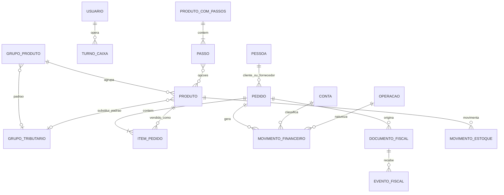

# Retaguarda Sischef: mapa de telas, dados e interface

Inspeção somente leitura da sessão autenticada da cafeteria em 04/11/2026.
Complementa `referencia-sistema-sischef-20261103.md`,
`sischef-reaudit-20261103.md` e o material em `../../sischef-extraction/`.
Não se salvaram formulários, emitiram notas ou exportaram dados pessoais.

## Navegação e desenho observado

A retaguarda é uma aplicação Web em `sistema.sischef.com`, com rotas `.jsf`.
Há uma barra superior rosa forte com nome da empresa e atalhos, menu lateral
branco com busca e módulos expansíveis, e uma área central cinza clara com
cartões brancos. Nas listagens, o padrão é título/subtítulo, atalhos `Novo` e
`Listagem`, busca, `Filtros`, tabela paginada (10 linhas por padrão), ações
`Editar`/menu por linha e contador de registros. O formulário de produto usa
abas; parâmetros usam painéis expansíveis com salvamento **por linha**. Este é
um retrato visual da tela de produtos, não uma especificação de cores ou
medidas exatas. A interface também oferece uma nova tela de produtos ainda
apresentada como opção experimental.

| Área lateral | Telas observadas/endereços principais | Padrão de dados |
| --- | --- | --- |
| Cadastros | Pessoas, Usuários, Operadores PDV off | Pessoa, login, perfil, nível, ativo |
| Produtos/Taxas | Grupos, produtos simples, produtos com passos, taxas, preço por horário, precificação | Grupo, produto, passo/opção, preço, estoque |
| Financeiro | A pagar/receber, transferências, adiantamentos, consulta, extratos, baixas, recibos, resumo, DRE/DFC, cartões | Conta, operação, movimento, vencimento, baixa |
| Caixas | Conferência e turnos | Operador, abertura, fechamento, valores, conferência |
| Pedidos | Saída, compra, devoluções, consulta | Pedido, itens, pessoa, operação, pagamento |
| Notas fiscais | Painel, gerar, emitidas/recebidas, eventos, configuração, numerações, SPED | Emitente, documento, série, evento, status |
| PDV | Abrir PDV, itens excluídos/transferidos, senha | Comanda, pedido, auditoria operacional |
| Estoque | Acerto, entrada/saída manual | Produto, movimento, saldo |
| Relatórios | Principais, Excel | Consultas por área e exportações na réplica `SLAVE` |
| Configurações | Parâmetros, operações, contas, pagamentos, tributações, comandas/mesas | Regras compartilhadas entre módulos |
| Integrações | Integrações e API | Canais e conexões |

As URLs e a lista detalhada de módulos estão em
`referencia-sistema-sischef-20261103.md`. Algumas funções aparecem no menu,
mas a conta não tem acesso a elas; presença do link não prova uso operacional.

## Modelo de dados reconstruído

Relações abaixo são **inferência de domínio a partir de formulários e listas**,
não esquema SQL do fornecedor. Os dumps nativos de setembro estão fora do Git
e suas colunas sem cabeçalho ainda exigem validação.

**Produto simples:** ID, descrição, grupo, unidade, código de barras,
NCM/CEST, custo, preço, ativo e observações. A aba complementar adiciona
controle e mínimos de estoque, política de venda sem saldo, tipo de produto,
local de notificação (nenhum/cozinha/bar), ficha impressa, taxa de serviço e
conversão de unidade de compra para venda. A aba fiscal contém origem,
percentual aproximado de tributos, benefício fiscal, inclusão de item gratuito
na NF, unidade/quantidade tributável e valor pauta. Há abas de imagens e
estoque da empresa. Exemplo observado: Água com gás, ID 2297141, NCM
22011000, CEST 0300100, código 913 e preço R$ 8,00; é um exemplo de tela,
não regra fiscal para os demais produtos.

**Precedência fiscal explicitada na tela:** grupo tributário associado ao
produto vence; caso não exista, busca-se o grupo tributário do grupo de
produto. NCM/CEST e origem são atributos do produto. O grupo tributário
concentra regras como CFOP e CSOSN. O grupo de produto também controla
visibilidade por canal e notificação padrão; o produto pode escolher seu
próprio destino de notificação. No formulário do grupo `BEBIDAS GELADAS`, as
visibilidades são caixas separadas para PDV online, smartphone, SmartPOS, PDV
offline e pedido franqueado; também há ativo, cor e destino de notificação,
mais uma aba própria de tributação.
O grupo observado foi `BEBIDAS GELADAS` (ID 68461). A tentativa de abrir sua
aba de tributação em 04/11 excedeu o tempo do navegador automatizado;
portanto o vínculo fiscal **efetivo** desse grupo não foi confirmado nesta
rodada. Não atribuir a ele um dos dois perfis por suposição.

**Produto com passos:** descrição, grupo, preço base, abertura automática ou
manual, ativo e observações. Cada passo tem descrição, mínimo, máximo, ordem,
nível (subitem ou mesmo nível do principal), cobrança (fração, maior valor ou
unitário), texto no cardápio e uma lista de produtos associados com preço
próprio, inclusão automática e quantidade. O exemplo `CERVEJA` tem um passo
obrigatório (1 de 1) e seis cervejas com preços diferentes. Isso explica por
que um produto da seção cervejas pode ter preço menor sem mudar o preço dos
demais: o preço está na opção do passo. Os produtos que compõem opções
mantêm cadastro próprio, inclusive código de barras e classificação fiscal.

**Financeiro e caixa:** a consulta separa despesas, receitas, todos e por
data; filtra por vencimento ou lançamento e período. A tabela liga descrição/
pessoa, conta/operação, tipo, datas, valor e ações. A conferência liga usuário,
abertura, fechamento, observação e impressão; havia 14 de 14 caixas recentes
pendentes no momento da leitura. Isto é estado operacional, não condição
necessária para replicar a interface. DRE e DFC usam bases diferentes e não
devem ser conciliados apenas por totais de tela.

**Usuários:** o formulário associa login a uma pessoa/funcionário e distingue
`Supervisor da empresa` de `Operador`. As permissões podem vir de perfil pronto
ou de seleção manual por módulos: acessos, cadastros, PDV online, financeiro,
caixa/turno, compras/vendas, estoque, notas fiscais, Analytics, Sischef,
cardápio e integrações. A interface avisa que algumas permissões são negativas
(`Não permite`), portanto marcar um grupo inteiro pode também marcar bloqueios.
Não foram copiadas senhas nem toda a árvore de permissões do operador.

**Pagamentos:** cinco formas ativas na lista: dinheiro, integração com apps,
débito, crédito e PIX. A forma tem ID, descrição, ordem, tipo, cor e ativo.
Débito mostra vencimento D+2 e crédito D+30, ambos com baixa automática;
o vínculo entre forma, conta e operação deve ser verificado no formulário antes
de replicar a contabilização.

**Fiscal:** a configuração de emitente, documentos e tributações já está
detalhada nos dois relatórios anteriores. A leitura de menus/listas não
equivale à prova de vínculos fiscais aplicados a cada item ou ao XML
efetivamente autorizado. A sequência de produção precisa ser relida no dia
da migração.

## Regras de interface a preservar no Farelo OS

1. Navegação por módulos, busca no menu, filtros e paginação, com nome claro
da tela e ações por linha.
2. Produto, grupo e produto com passos são conceitos distintos. Preço da
opção não deve alterar o preço global do produto simples.
3. O destino de impressão/notificação pode vir do grupo ou ser definido no
produto; o pedido deve registrar o destino efetivo quando é confirmado.
4. Regra fiscal do produto tem prioridade sobre a regra herdada do grupo;
mostrar a **origem da regra efetiva** na revisão fiscal.
5. Movimento financeiro deve registrar conta, operação, data de lançamento,
vencimento e liquidação separadamente. Caixa deve ter trilha de abertura,
fechamento e conferência.
6. Relatórios precisam expor filtros e base de cálculo. Pedido, pagamento,
movimento financeiro e NFC-e são registros relacionados, mas não idênticos.

## Cobertura e próximos levantamentos

Nesta rodada foram abertos diretamente: início, listagem e formulário de
produto simples (abas principais, complementares e fiscais), listagem de
grupos (lista e formulário), listagem e formulário de produto com passos,
usuários (lista e formulário), parâmetros financeiros, formas de
pagamento, consulta financeira, conferência de caixas, pedidos, Painel Fiscal,
configuração fiscal e exportações. Os documentos anteriores registram outras
áreas.
Ainda falta auditar **cada** formulário e estado de erro/vazio, os vínculos
fiscais dos itens atuais em lote, o esquema completo dos dumps sem cabeçalho,
permissões finas e a conciliação por transação. Não se deve chamar este mapa
de cópia integral do banco ou de paridade visual completa.

REA MCP: a análise estática do bundle do PDV continuou indisponível por
incompatibilidade Swift/SDK local, documentada em
`pdv-sischef-fluxo-comanda-20261103.md`. Esta rodada usa evidência da UI
autenticada e arquivos previamente exportados, não rotas ou entidades
supostamente recuperadas pela REA.
